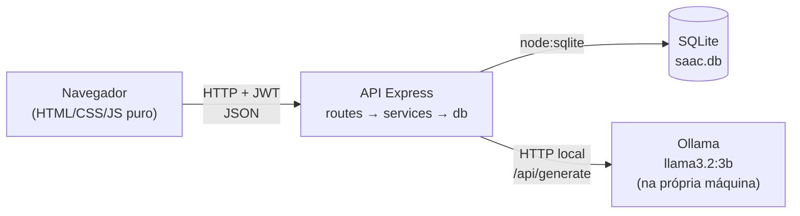
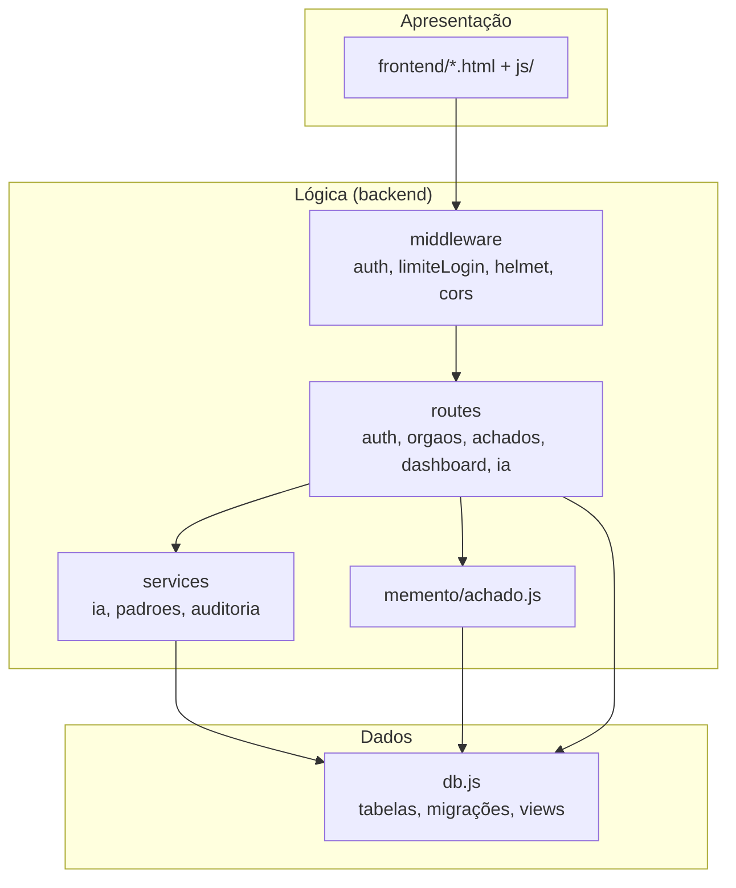
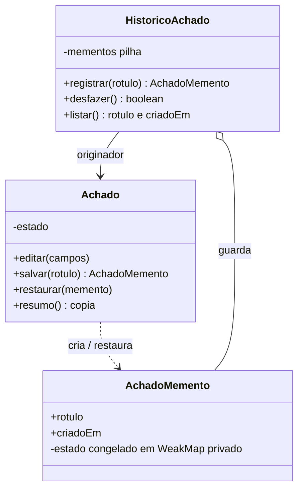

# SAAC — Sistema de Achados de Auditoria e Conformidade

[](https://github.com/gustavomaiaa/saac_aps/actions/workflows/ci.yml)

## Índice

1. [Objetivo](#1-objetivo)
2. [Requisitos funcionais](#2-requisitos-funcionais)
3. [Arquitetura](#3-arquitetura)
4. [Padrões aplicados](#4-padrões-aplicados)
5. [IA local e privacidade (LGPD)](#5-ia-local-e-privacidade-lgpd)
6. [Rastreabilidade: requisito → tela/endpoint → teste](#6-rastreabilidade-requisito--telaendpoint--teste)
7. [Como rodar](#7-como-rodar)
8. [Usuários de teste](#8-usuários-de-teste)
9. [Endpoints da API](#9-endpoints-da-api)
10. [Estrutura de pastas](#10-estrutura-de-pastas)
11. [Regras de negócio](#11-regras-de-negócio)
12. [Segurança](#12-segurança)
13. [Limitações conhecidas](#13-limitações-conhecidas)

---

## 1. Objetivo

O SAAC permite que auditores registrem **achados de auditoria** vinculados a **órgãos auditados**, acompanhem a
situação de cada achado (Em aberto → Em análise → Implementado/Rejeitado), consultem indicadores em um dashboard e
exportem relatórios. Uma **IA local (Ollama)** apoia o auditor sugerindo recomendações e interpretando padrões nos dados,
**sem que nenhuma informação saia da máquina**. Toda alteração é rastreável (histórico com desfazer e trilha de auditoria).

Stack: Node.js + Express, SQLite nativo (`node:sqlite`), JWT, HTML/CSS/JavaScript puro e Ollama.

## 2. Requisitos funcionais

| ID | Requisito |
|----|-----------|
| RF01 | Cadastro e login de usuários com senha protegida por hash e sessão por JWT |
| RF02 | CRUD de órgãos (não excluir órgão que possui achados) |
| RF03 | CRUD de achados vinculados a um órgão, com severidade, status e recomendação |
| RF04 | Listar achados com filtros (severidade, status, órgão), busca textual e paginação |
| RF05 | Exclusão lógica de achados (o registro é preservado) |
| RF06 | Dashboard com totais, distribuição por severidade/status e órgãos com mais achados |
| RF07 | Recomendação automática por IA local, editável, com Aceitar/Descartar |
| RF08 | Análise de padrões por IA local sobre fatos calculados pelo sistema |
| RF09 | Explicabilidade e métricas da IA (modelo, tempo, base utilizada, taxa de aceitação) |
| RF10 | Histórico de edições e desfazer da última edição (padrão Memento) |
| RF11 | Trilha de auditoria (quem fez o quê e quando) de criar, editar, excluir e restaurar achados |
| RF12 | Exportação de achados em CSV respeitando os filtros |
| RF13 | Relatório imprimível (resumo, análise de padrões e tabela de achados) |
| RF14 | Permissões: só o criador do achado ou um administrador edita, exclui e desfaz |
| RF15 | Proteções: limite de tentativas de login, cabeçalhos de segurança e CORS restrito |
| RF16 | Severidade sugerida por IA local (valor validado, justificativa curta), confirmada pelo usuário |
| RF17 | Achados semelhantes por embeddings, com alerta de possível duplicidade ao cadastrar |

## 3. Arquitetura



Dentro do backend, as responsabilidades ficam em camadas:



## 4. Padrões aplicados

### 4.1 Cliente-Servidor em três camadas

- **Apresentação:** frontend estático (HTML/CSS/JS), sem regras de negócio críticas — o servidor revalida tudo.
- **Lógica de negócio:** Express (middlewares, rotas e serviços de IA, padrões e auditoria).
- **Dados:** SQLite com migrações idempotentes e views (`vw_achados_detalhados`, `vw_resumo_orgaos`).

### 4.2 Camadas `routes / services / db`

- `routes/` recebem a requisição, validam entrada, aplicam permissões e montam a resposta HTTP.
- `services/` concentram regras reutilizáveis e integrações (`ia.js` fala com o Ollama; `padroes.js` calcula fatos e valida a
  resposta da IA; `auditoria.js` grava e consulta a trilha).
- `db.js` é o único ponto que abre o banco, cria tabelas/views e executa migrações.

### 4.3 Memento — `backend/memento/achado.js`

Permite **desfazer** edições de um achado sem expor o estado interno.



- `Achado` (*Originator*): estado em campo privado `#estado`; cria mementos e restaura a partir deles.
- `AchadoMemento` (*Memento*): cópia congelada (`Object.freeze`) guardada em um `WeakMap` **não exportado**; só `rotulo` e `criadoEm` ficam visíveis.
- `HistoricoAchado` (*Caretaker*): guarda a pilha e **nunca lê o estado**.
- Como o servidor não guarda memória entre requisições, os mementos são persistidos em `achados_historico` e reconstruídos
  dentro do mesmo módulo (`persistencia`), sem devolver o estado a quem chama. Os testes (`tests/memento.test.js`) provam que o estado não pode ser lido nem alterado de fora.

## 5. IA local e privacidade (LGPD)

A IA roda no **Ollama, na própria máquina** (`OLLAMA_URL`, padrão `http://localhost:11434`). Nenhum serviço externo é chamado.

| Recurso | A IA recebe | A IA **não** recebe |
|---------|-------------|---------------------|
| Recomendação | Título, descrição, severidade e nome/tipo do órgão do achado em edição | Usuários, e-mails, senhas, outros achados, histórico, auditoria |
| Severidade sugerida | Apenas título e descrição digitados no formulário | Órgão, usuários, outros achados |
| Achados semelhantes | Título e descrição (texto do achado novo e de cada achado salvo, para gerar o vetor) | Usuários, e-mails, senhas, histórico, auditoria |
| Análise de padrões | Apenas **fatos agregados** (contagens, rankings e percentuais) calculados pelo sistema | Títulos, descrições ou qualquer texto individual dos achados |

Medidas alinhadas a princípios da **LGPD**:

- **Minimização e finalidade (art. 6º):** só o necessário é enviado ao modelo, e apenas para apoiar o auditor.
- **Segurança (art. 6º, VII):** os dados não saem do equipamento; senhas com bcrypt; JWT; cabeçalhos de segurança.
- **Transparência:** toda resposta de IA mostra **modelo, tempo e base utilizada**; cada uso fica em `ia_uso` com o resultado (aceita/descartada).
- **Supervisão humana:** a IA só sugere. O auditor revisa, edita e escolhe Aceitar ou Descartar; avisos explícitos na tela.
- **Rastreabilidade:** a trilha de auditoria registra quem alterou cada achado, e o histórico permite desfazer.
- **Atenção do usuário:** se o texto de um achado contiver dados pessoais, ele será processado pelo modelo local (sem sair da máquina), mas deve ser evitado quando desnecessário.

> Este projeto é acadêmico e este texto não substitui parecer jurídico sobre conformidade com a LGPD.

**Severidade sugerida:** a IA responde em JSON (`format: json`); o servidor faz *parse seguro* e só aceita um dos valores
`Crítico`, `Alto`, `Médio` ou `Baixo` (senão responde **502** com mensagem clara). A justificativa é cortada em no máximo 2 frases e é
**omitida** se citar leis/artigos/decretos ou números que não estejam no texto do achado. O campo é preenchido como *sugestão*: o usuário
escolhe **Aceitar** ou **Descartar**, e o uso é registrado em `ia_uso` (tipo `severidade`) e exibido nas métricas.

**Achados semelhantes:** usa o modelo de embeddings **`nomic-embed-text`** (`ollama pull nomic-embed-text`). O vetor de cada achado fica na
tabela `achados_embedding` (JSON, modelo e data), gerado em segundo plano ao criar/editar, ou em lote com `npm run embeddings`
(o `npm run seed` também tenta gerar). A comparação é por **cosseno calculado em JavaScript**; a API devolve os 3 mais parecidos com
similaridade ≥ limiar (`SEMELHANTES_LIMIAR`, padrão 0,80) e marca **possível duplicidade** quando o melhor passa de
`SEMELHANTES_LIMIAR_DUPLICIDADE` (padrão 0,90). Se o Ollama ou o modelo de embeddings estiver ausente, o formulário continua normal, apenas sem a
sugestão (a API responde 503 com "Execute: ollama pull nomic-embed-text").

**Como a análise de padrões evita erros:** o sistema compara os números em JavaScript e gera *fatos numerados* prontos
(ex.: "[2] A severidade mais frequente é Alto, com 5 de 12 achados (42%)."). O modelo (temperature 0.2, `num_predict` 400) **interpreta** os fatos
em 3 observações — *Risco*, *Concentração* e *Tendência* — mais uma *Ação prioritária*, citando os fatos entre colchetes (ex.: `[2][6]`).
Cada linha é validada: citação `[n]` inexistente, ausência de citação, números fora dos fatos, linha cortada ou **cópia quase idêntica de um fato** são
**descartados**; com menos de 2 observações úteis, só os fatos são exibidos, com a mensagem "A IA não conseguiu interpretar com segurança; veja os fatos acima."
No dashboard, os "Fatos calculados" ficam recolhidos e a "Interpretação da IA" aparece em destaque. A validação garante a *ligação com os fatos*, não a
*correção do raciocínio*: o texto interpretativo do modelo pode conter generalizações sem base e deve ser revisado.
A recomendação proíbe citar leis, artigos e números que não estejam no achado. Se o Ollama estiver desligado, o restante do sistema continua
funcionando e a IA informa "IA local indisponível. Verifique se o Ollama está em execução."

## 6. Rastreabilidade: requisito → tela/endpoint → teste

| Requisito | Tela | Endpoint(s) | Teste automatizado |
|-----------|------|-------------|--------------------|
| RF01 Cadastro/login | `cadastro.html`, `login.html` | `POST /api/auth/cadastro`, `POST /api/auth/login`, `GET /api/auth/verify` | `achados-validacao` (cadastro), `permissoes`, `seguranca` (hash bcrypt) |
| RF02 Órgãos | `orgaos.html` | `/api/orgaos` | `exclusao` (409), `achados-validacao` |
| RF03 Achados | `achados.html` | `POST/GET/PUT/DELETE /api/achados` | `achados-validacao`, `ia` (recomendação no CRUD) |
| RF04 Filtros/paginação | `achados.html` | `GET /api/achados?...` | `achados-filtros` |
| RF05 Exclusão lógica | `achados.html` | `DELETE /api/achados/:id` | `exclusao` |
| RF06 Dashboard | `dashboard.html` | `GET /api/dashboard` | `dashboard` |
| RF07 Recomendação IA | `achados.html` (Gerar com IA) | `POST /api/ia/recomendacao`, `POST /api/ia/uso/:id/resultado` | `ia` (sucesso, 503, 504, 502) |
| RF08 Análise de padrões | `dashboard.html` | `GET /api/ia/padroes` | `ia` (fatos, número inventado, sem linhas válidas) |
| RF09 Métricas IA | `dashboard.html` | `GET /api/ia/metricas`, `GET /api/ia/status` | `ia` (métricas) |
| RF10 Histórico/desfazer | `achados.html` (edição) | `GET .../historico`, `POST .../desfazer` | `memento` |
| RF11 Auditoria | `achados.html` (aba Histórico de auditoria) | `GET /api/achados/:id/auditoria` | `auditoria` |
| RF12 CSV | `achados.html` (Exportar CSV) | `GET /api/achados/exportar.csv` | `csv` |
| RF13 Relatório | `relatorio.html` | `GET /api/dashboard`, `GET /api/achados` | cobertura indireta pelos testes dos endpoints (tela verificada manualmente) |
| RF14 Permissões | `achados.html` (botões por perfil) | `PUT/DELETE/POST desfazer` → 403 | `permissoes` |
| RF15 Proteções | `login.html` (mensagem 429) | `POST /api/auth/login` | `seguranca` |
| RF16 Severidade sugerida | `achados.html` (Sugerir severidade com IA) | `POST /api/ia/severidade` | `ia-severidade-semelhantes` (válida, inválida 502, justificativa, 503) |
| RF17 Achados semelhantes | `achados.html` (Achados parecidos / duplicidade) | `GET /api/ia/semelhantes`, `npm run embeddings` | `ia-severidade-semelhantes` (cosseno, limiar, modelo ausente, reindexação) |
| Dados de demonstração | — | `npm run seed` | `seed` |

## 7. Como rodar

Requisitos: **Node.js 22.5+** (módulo `node:sqlite`) e, para a IA, o **Ollama**. O CI valida o projeto no **Node 22**
(`npm ci` + `npm test`, 79 testes), e o desenvolvimento local foi feito no Node 24.

### 7.1 Ollama (IA local)

```bash
# instale em https://ollama.com/download e depois:
ollama pull llama3.2:3b          # modelo de texto
ollama pull nomic-embed-text     # embeddings (achados semelhantes)
```

### 7.2 Local (sem Docker)

```bash
cd backend
npm install
copy .env.example .env        # Linux/macOS: cp .env.example .env  (troque o JWT_SECRET)
npm start                     # API em http://localhost:3000
npm run seed                  # (opcional) dados de demonstração (gera embeddings se o Ollama estiver no ar)
npm run embeddings            # (opcional) gera embeddings dos achados existentes (--todos para regenerar)
npm test                      # testes (não exigem Ollama)
```

Frontend (estático) — o CORS libera por padrão `http://localhost:5500`, `http://127.0.0.1:5500` e `http://localhost:8080`:

```bash
cd frontend
python -m http.server 5500    # abra http://localhost:5500/login.html
```

### 7.3 Com Docker

O Ollama **roda no host**, não em container; o backend o acessa por `OLLAMA_URL=http://host.docker.internal:11434` (já definido no compose).

```bash
docker compose up --build -d              # backend :3000 e frontend :8080
docker compose exec backend node seed.js  # (opcional) dados de demonstração
# abra http://localhost:8080/login.html
docker compose down                       # use "down -v" para apagar também o banco (volume saac-dados)
```

### 7.4 Variáveis de ambiente (`backend/.env`)

| Variável | Padrão | Descrição |
|----------|--------|-----------|
| `PORT` | `3000` | Porta da API |
| `JWT_SECRET` | — | Segredo dos tokens (**obrigatório; troque**) |
| `JWT_EXPIRES_IN` | `2h` | Validade do token |
| `CORS_ORIGIN` | `http://localhost:5500,http://127.0.0.1:5500,http://localhost:8080` | Origens do frontend permitidas (vírgula) |
| `LOGIN_MAX_TENTATIVAS` / `LOGIN_JANELA_MS` | `5` / `900000` | Falhas de login por IP e janela (15 min) |
| `OLLAMA_URL` | `http://localhost:11434` | Endereço do Ollama |
| `OLLAMA_MODEL` | `llama3.2:3b` | Modelo |
| `OLLAMA_TIMEOUT_MS` | `120000` | Tempo máximo de espera pela IA |
| `OLLAMA_EMBED_MODEL` | `nomic-embed-text` | Modelo de embeddings |
| `SEMELHANTES_LIMIAR` | `0.80` | Similaridade mínima para listar um achado parecido |
| `SEMELHANTES_LIMIAR_DUPLICIDADE` | `0.90` | Similaridade a partir da qual aparece o alerta de possível duplicidade |
| `SAAC_DB_PATH` | `backend/saac.db` | Arquivo do banco (usado pelos testes e pelo Docker) |

## 8. Usuários de teste

Após `npm run seed`:

| E-mail | Senha | Perfil |
|--------|-------|--------|
| `admin@saac.demo` | `admin123` | administrador |

O seed cria ainda 4 órgãos e 12 achados (a Prefeitura e a Secretaria de Saúde são reincidentes). Para ver as permissões, cadastre
um segundo usuário pela tela de cadastro (ele entra como `auditor`). O primeiro usuário cadastrado de um banco vazio vira `admin`.

## 9. Endpoints da API

Todas as rotas, exceto cadastro/login/health, exigem `Authorization: Bearer <token>`. Token ausente, inválido ou expirado → `401`.

| Método | Rota | Descrição |
|--------|------|-----------|
| GET | `/api/health` | Verificação de saúde |
| POST | `/api/auth/cadastro` | Cadastro (1º usuário = `admin`, demais = `auditor`) |
| POST | `/api/auth/login` | Login (`429` após 5 falhas em 15 min por IP) |
| GET | `/api/auth/verify` | Valida o token e devolve o usuário |
| POST / GET | `/api/orgaos` | Criar / listar órgãos |
| GET / PUT / DELETE | `/api/orgaos/:id` | Detalhe / editar / excluir (`409` se tiver achados) |
| POST | `/api/achados` | Criar achado |
| GET | `/api/achados` | Listar: `severidade`, `status`, `orgao_id`, `q`, `pagina`, `limite` → `{ dados, total, pagina, paginas }` |
| GET | `/api/achados/exportar.csv` | CSV (UTF-8 com BOM, `;`) com os mesmos filtros |
| GET | `/api/achados/:id` | Detalhe |
| PUT | `/api/achados/:id` | Editar (snapshot + auditoria) — criador ou admin |
| DELETE | `/api/achados/:id` | Exclusão lógica — criador ou admin |
| GET | `/api/achados/:id/historico` | Histórico de edições (`rotulo`, `criado_em`) |
| POST | `/api/achados/:id/desfazer` | Desfaz a última edição (`409 "Nada a desfazer."`) |
| GET | `/api/achados/:id/auditoria` | Trilha de auditoria (quem, ação, quando, antes/depois, campos alterados) |
| GET | `/api/dashboard` | Totais, por severidade, por status, top 5 órgãos |
| GET | `/api/ia/status` | Ollama no ar? Modelo instalado? |
| POST | `/api/ia/severidade` | `{ titulo, descricao }` → `{ severidade, justificativa, modelo, tempo_ms, uso_id }` (502 se a severidade vier inválida) |
| GET | `/api/ia/semelhantes` | `?titulo&descricao[&orgao_id&excluir_id]` → 3 mais parecidos `{ id, titulo, orgao_nome, severidade, percentual }` + `possivel_duplicidade` |
| POST | `/api/ia/recomendacao` | `{ recomendacao, modelo, tempo_ms, base_utilizada, uso_id }` |
| GET | `/api/ia/padroes` | `{ estatisticas, fatos, analise, interpretado, modelo, tempo_ms }` |
| POST | `/api/ia/uso/:id/resultado` | `{ resultado: "aceita" \| "descartada" }` |
| GET | `/api/ia/metricas` | Usos, tempo médio e taxa de aceitação |

Erros da IA: `503` (Ollama fora do ar/modelo ausente), `504` (tempo esgotado), `502` (resposta vazia ou inválida).

## 10. Estrutura de pastas

```
saac_aps/
├── README.md, PROGRESSO.md, docker-compose.yml
├── .github/workflows/ci.yml      # npm ci + npm test no Node 22
├── docs/ROTEIRO_DEMO.md          # demonstração de 5 minutos
├── backend/
│   ├── server.js                 # app Express (helmet, CORS); só escuta a porta se executado direto
│   ├── db.js                     # SQLite, migrações idempotentes e views
│   ├── seed.js, embeddings.js, Dockerfile
│   ├── middleware/               # auth.js (JWT + perfil), limiteLogin.js
│   ├── routes/                   # auth, orgaos, achados, dashboard, ia
│   ├── services/                 # ia.js, padroes.js, auditoria.js, semelhantes.js
│   ├── memento/achado.js         # padrão Memento
│   └── tests/                    # node:test + servidor Ollama falso
└── frontend/
    ├── login, cadastro, dashboard, orgaos, achados, relatorio (.html)
    ├── css/style.css
    └── js/                       # config.js (helpers) + um script por tela
```

## 11. Regras de negócio

- Todo achado pertence a um órgão e registra quem o criou. Título com no mínimo 5 caracteres; recomendação com até 2000.
- Severidades: Crítico, Alto, Médio, Baixo. Status: Em aberto, Em análise, Implementado, Rejeitado.
- Órgão com achados (ativos ou excluídos logicamente) não pode ser excluído (`409`).
- Exclusão lógica: preenche `excluido_em`; o achado some de listagens, dashboard, CSV e IA, mas continua no banco.
- Só o criador ou um `admin` edita, exclui e desfaz (`403` caso contrário).
- Cada edição grava um snapshot (Memento) e um registro de auditoria; criar, excluir e restaurar também são auditados.
- Qualquer resposta `401` limpa o token e leva ao login.

## 12. Segurança

- Senhas com **bcrypt** (custo 10); o seed também usa bcrypt.
- **helmet** (cabeçalhos HTTP), **CORS** restrito a `CORS_ORIGIN`, **limite de 5 falhas de login por IP em 15 min** (`429` com mensagem clara na tela de login).
- Consultas SQL parametrizadas; o frontend escapa texto dinâmico antes de inserir no HTML.

## 13. Limitações conhecidas

- A IA (modelo 3B) **pode errar**; sempre revisar. A validação checa os números citados, não o sentido do texto. O modelo tende a repetir os fatos quase literalmente.
- A similaridade por embeddings tem "ruído de fundo": com o limiar padrão (0,80) ainda podem aparecer achados só vagamente relacionados; ajuste `SEMELHANTES_LIMIAR`. A busca compara com todos os vetores em JavaScript (adequado para centenas/milhares de achados, não para milhões).
- A severidade sugerida é um apoio: o modelo 3B tende a classificar de forma conservadora e pode divergir do julgamento do auditor.
- O limite de tentativas de login fica **em memória**: reinicia com o servidor e não é compartilhado entre instâncias.
- O token JWT fica no `localStorage` do navegador e não há *refresh token*; a sessão expira em 2 h.
- Dois perfis apenas (admin/auditor); não há gestão de usuários pela interface.
- A auditoria cobre apenas achados (não órgãos nem usuários); achados criados pelo seed não possuem registros de criação.
- Não há testes automatizados de interface (E2E); as telas foram verificadas manualmente. O relatório depende de a análise de padrões ter sido gerada na mesma sessão do navegador.
- SQLite em arquivo único (uma instância); `node:sqlite` ainda é marcado como experimental pelo Node.
- `JWT_SECRET` de exemplo deve ser trocado fora do ambiente acadêmico; não há HTTPS embutido (use um proxy reverso em produção).
- Abrir os HTML direto do disco (`file://`) não funciona mais por causa do CORS restrito: sirva a pasta `frontend/`.
